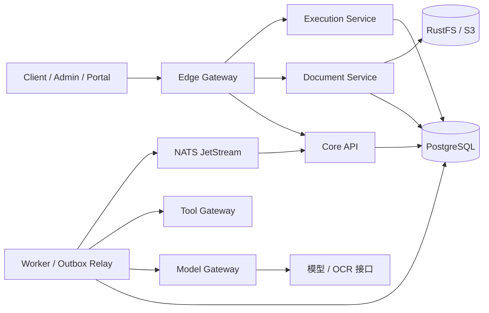

# 合同智能审计工作台

基于 Go 和 React 的合同审计工作台，用于组织合同材料、执行规则核对、查看带引用的模型建议，并记录人工复核、整改和复审。

## 项目架构

前端使用 React、TypeScript、Ant Design 和 TanStack Query，分为业务工作台 Client、规则管理 Admin 和接口文档 Portal。后端使用 Go 和 Eino，提供案件、文档、审查执行、模型调用和工具服务。PostgreSQL 保存业务状态与执行记录，RustFS/S3 保存原件，NATS JetStream 用于独立服务模式下的事件通知。

独立服务按下图组织：



本地开发默认使用 `cmd/server` 的单进程模式，将 API 和审查执行放在同一进程中；独立服务模式使用各自的启动入口和数据库角色。

```text
cmd/                 服务、迁移和命令行入口
internal/            业务逻辑、规则、解析、权限、存储和服务客户端
web/                 Client、Admin、Portal 源码与前端配置
deploy/               Docker 镜像、Nginx 配置和基础设施脚本
deployments/          Compose 启动工具与 Kubernetes 配置
scripts/             开发、测试和验证脚本
testdata/            小型回归测试输入
compose.yaml         PostgreSQL、RustFS 等本地基础设施
compose.app.yaml     独立服务部署配置
```

仓库保留源码、配置、依赖锁文件和必要的小型测试资源。合同样本、演示预置材料、设计文档、截图、课件、模型权重和运行产物不随源码提供。

## 本地启动

需要 Go 1.26.7+、Bun 1.4.3、Node.js 22.12+、Python 3.10+，以及可用的 Docker Engine/Desktop 和 Compose v2。解析 PDF 还需要 Poppler 的 `pdfinfo`、`pdftotext`、`pdfimages`、`pdftoppm` 及 CJK mappings。

在仓库根目录安装依赖、生成本机配置并启动基础设施：

```bash
make setup
make infra-bootstrap
make infra-config
make infra-up
make infra-smoke
```

`infra-bootstrap` 生成私有的 `.env` 和 `.env.distributed`，已有文件不会被覆盖。配置项见 [.env.example](.env.example)。数据库和对象存储凭据保存在本机，不提交到 Git。

Go 不会自动加载 `.env`。在第一个终端启动 API：

```bash
set -a
source .env
set +a
make dev
```

在另一个终端启动前端：

```bash
make web
```

默认 API 地址为 `http://127.0.0.1:8080`，前端为 `http://127.0.0.1:5173`。开发模式默认账号为 `demo-admin / admin-demo`；生产模式拒绝固定演示身份。Vite 将 `/api` 和 `/openapi.json` 代理到 API，可通过 `VITE_DEV_API_PROXY` 修改目标地址。

模型与 OCR 服务需自行提供，在 `.env` 中设置 `LLM_BASE_URL`、`LLM_MODEL`、`OCR_MODEL` 和 `LLM_API_KEY`。模型不可用时，相关审查会按执行结果记录失败或部分完成，不会自动产生模型结论。

本地停止基础设施可执行 `make infra-stop`，该命令保留数据卷。

## 独立服务启动

完成上述配置，并确认模型接口可以从容器访问后，构建并启动独立服务：

```bash
make apps-up
```

此入口通过 `compose.app.yaml` 启动 Gateway、Core、Document、Execution、Worker、Model/Tool Gateway 和三个前端站点。模型接口必须在容器网络中可达；容器内的 `127.0.0.1` 指向容器自身。主机端口由 `.env` 中的 `EDGE_PORT`、`CLIENT_PORT`、`ADMIN_PORT` 和 `PORTAL_PORT` 控制。

分站部署时，通过 `VITE_ADMIN_URL` 指定 Admin 地址；留空时使用同源 `/admin/rulepacks`。三个站点也可以分别构建：

```bash
make web-client
make web-admin
make web-portal
```

## 开发检查

```bash
make test-unit                  # 不依赖数据库或模型的 Go 测试，包含 race
cd web
bun run typecheck
bun run test
bun run build
```

需要数据库的集成测试使用隔离的 `TEST_DATABASE_URL`。`make verify` 执行确定性检查，`make acceptance` 进一步执行浏览器旅程；真实模型/OCR 联调由 `make test-live` 单独启用。
