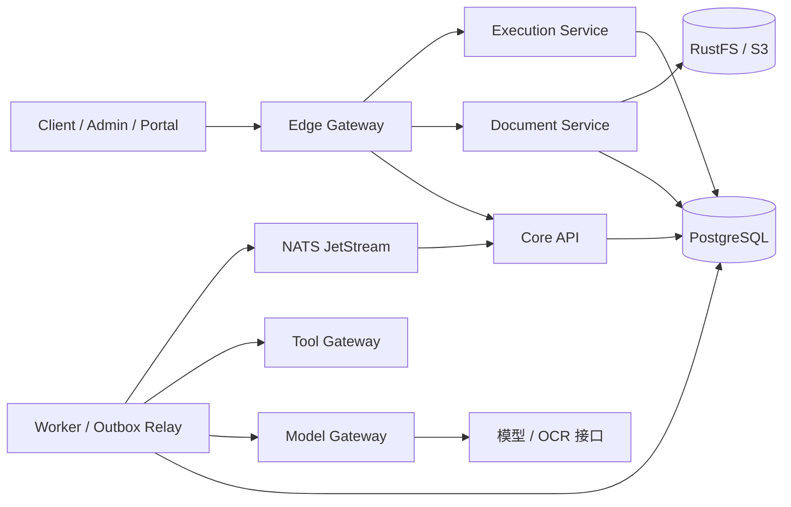

# 合同智能审计工作台

基于 Go 和 React 的合同审计工作台，用于组织合同材料、执行规则核对、查看带引用的模型建议，并记录人工复核、整改和复审。

业务工作台展示“第一届黄桷树AI智能体开发大赛”标题及赛事 Logo，产品名称为合同智能审计工作台。

审查引用保留跨行的否定与限定语，并绑定冻结原文的位置。制度版本以租户、制度标识和版本号区分；不同租户可以独立保存同名制度，已有版本保持不可变。知识库按精确版本选择和读取，并支持版本链接；旧的单 ID 接口保留读取最新记录的语义。

## 项目架构

前端使用 React、TypeScript、Ant Design 和 TanStack Query，分为业务工作台 Client、规则管理 Admin 和接口文档 Portal。后端使用 Go 和 Eino，提供案件、文档、审查执行、模型调用和工具服务。PostgreSQL 保存业务状态与执行记录，RustFS/S3 保存原件，NATS JetStream 用于独立服务模式下的事件通知。

三站共用 Ant Design 主题：导航使用黑色并按功能分组，保留标准图标，不显示菜单编号；内容使用白色和浅蓝灰，主要操作与选中项使用蓝色。蓝、橙、红、绿分别表示信息与进度、警告、错误和成功状态。颜色由 `web/src/styles.css` 的语义 Token 定义，经 `web/src/bootstrap.tsx` 配置到组件；普通链接样式置于组件样式之前，保留主按钮和状态标签的对比度。

主页的审查链路和业务模块标题使用 17px，统计卡片标题使用 15px，窄屏沿用相同层级。宽屏时任务窗格与右侧统计窗格上下对齐，窄屏按可用宽度重排。

系统健康页按分组展示服务状态、连接目标和观测说明，支持筛选、搜索和查看详情。版本对照页在宽屏并排显示冻结正文，窄屏纵向排列；选择审查发现可定位到对应原文。

审查工作区顶部可直达执行检查器，按时间线或事件树查看当前尝试的持久事件；选择事件可查看原始阶段、状态、用量和关联标识，也可切换历史尝试。未记录的数据保持未报告。

独立服务按下图组织：



本地开发默认使用 `cmd/server` 的单进程模式，将 API 和审查执行放在同一进程中；独立服务模式使用各自的启动入口和数据库角色。

```text
cmd/                 服务、迁移和命令行入口
internal/            业务逻辑、规则、解析、权限、存储和服务客户端
web/                 Client、Admin、Portal 源码与前端配置
deploy/               Docker 镜像、Nginx 配置和基础设施脚本
deployments/          Compose 启动工具与 Kubernetes 配置
scripts/             开发、测试和验证脚本
testdata/            小型回归测试输入
compose.yaml         PostgreSQL、RustFS 等本地基础设施
compose.app.yaml     独立服务部署配置
```

仓库保留源码、配置、依赖锁文件和必要的小型测试资源。合同样本、演示预置材料、设计文档、截图、课件、模型权重和运行产物不随源码提供。

## 本地启动

需要 Go 1.26.7+、Bun 1.4.3、Node.js 22.12+、Python 3.10+，以及可用的 Docker Engine/Desktop 和 Compose v2。解析 PDF 还需要 Poppler 的 `pdfinfo`、`pdftotext`、`pdfimages`、`pdftoppm` 及 CJK mappings。

在仓库根目录安装依赖、生成本机配置并启动基础设施：

```bash
make setup
make infra-bootstrap
make infra-config
make infra-up
make infra-smoke
```

`infra-bootstrap` 生成私有的 `.env` 和 `.env.distributed`，已有文件不会被覆盖。配置项见 [.env.example](.env.example)。数据库和对象存储凭据保存在本机，不提交到 Git。

Go 不会自动加载 `.env`。在第一个终端启动 API：

```bash
set -a
source .env
set +a
make dev
```

在另一个终端启动前端：

```bash
make web
```

默认 API 地址为 `http://127.0.0.1:8080`，前端为 `http://127.0.0.1:5173`。Vite 将 `/api` 和 `/openapi.json` 代理到 API，可通过 `VITE_DEV_API_PROXY` 修改目标地址。

开发和测试模式提供以下固定演示账号；生产环境禁止使用这些账号，配置企业身份目录时本地密码登录也会停用。账号默认仅能访问自己创建或明确加入的案件，租户和组织由服务端绑定。

| 账号 | 密码 | 角色 | 租户 | 组织 |
|---|---|---|---|---|
| `demo-admin` | `admin-demo` | 管理员 | `local-demo` | `demo-org` |
| `demo-clerk` | `clerk-demo` | 经办 | `local-demo` | `demo-org` |
| `demo-reviewer` | `reviewer-demo` | 审查员 | `local-demo` | `demo-org` |
| `demo-viewer` | `viewer-demo` | 只读 | `local-demo` | `demo-org` |
| `demo-otherorg-clerk` | `otherorg-clerk-demo` | 经办 | `local-demo` | `demo-other-org` |
| `demo-tenant2-admin` | `tenant2-admin-demo` | 管理员 | `local-demo-2` | `demo-org-2` |
| `demo-tenant2-clerk` | `tenant2-clerk-demo` | 经办 | `local-demo-2` | `demo-org-2` |
| `demo-tenant2-reviewer` | `tenant2-reviewer-demo` | 审查员 | `local-demo-2` | `demo-org-2` |
| `demo-tenant2-viewer` | `tenant2-viewer-demo` | 只读 | `local-demo-2` | `demo-org-2` |

模型与 OCR 服务需自行提供，在 `.env` 中设置 `LLM_BASE_URL`、`LLM_MODEL`、`OCR_MODEL` 和 `LLM_API_KEY`。模型不可用时，相关审查会按执行结果记录失败或部分完成，不会自动产生模型结论。

模型名称必须与该端点的 `/v1/models` 目录一致。代理目录可能包含提供方前缀；不要把请求能够接受的别名当作目录中的正式模型 ID。

### 真实合同联调

原件和运行记录放在源码仓外。在仓库外准备版本 1 的 JSON 清单，包含 `version`、`dataset_id` 和 `cases`；每个案例包含 `id`、`title`、`contract_type` 和 `materials`。每项材料需要 `role`、相对清单的 `path`、`sha256`、`source` 和 `data_class: "original"`；角色可以是 `draft_contract`、`procurement`、`award` 或 `attachment`。材料之间的关系和审查结论需要人工核验。

```bash
python3 scripts/record_model_proxy.py --upstream http://127.0.0.1:3425/v1 \
  --listen 127.0.0.1:3426 --out ../contract-audit-delivery/model-records/real-run
```

第二个命令保持运行，并在独立服务的模型配置中将 `LLM_BASE_URL` 指向该记录器，`LLM_MODEL` 与 `OCR_MODEL` 均设为真实模型目录中的名称。记录器只监听宿主机回环地址；容器服务需要受限的宿主网络转发才能访问。计算冻结模型身份的各服务必须使用相同的地址和模型名称。记录器只转发真实上游响应，不保存请求头，但请求和响应正文可能包含合同、图片及其他敏感数据，必须保存在私有目录。上游是否转发到外部取决于实际模型服务。

扫描页逐页转写。单文件上限为 32 MiB，模型网关仍按请求体字节作保守预算预留；需要根据页面大小和频率调整 `MODEL_MAX_INPUT_TOKEN_RESERVATION`、`MODEL_TENANT_TOKENS_PER_MINUTE`、`MODEL_GLOBAL_TOKENS_PER_MINUTE`。要覆盖最大 33 MiB 模型请求，单次预留至少为 34603008，全局与租户每分钟预算均须大于单次预留和输出额度之和。长文档还需按实际耗时配置 `DOCUMENT_PARSE_TIMEOUT`、`GATEWAY_REQUEST_TIMEOUT` 和 `GATEWAY_UPLOAD_TIMEOUT`；文档解析超时上限为 30 分钟。

模型网关对已声明超过 33 MiB 的请求在读取正文前拒绝；未声明长度的流仍在读取时按相同字节上限限制。

材料上传、重新解析和草稿生成在进入解析队列前检查角色与案件权限，提交时再次检查；队列满时仅对已授权请求返回容量不足。

DOCX 正文中的 Adobe Symbol 字体字符按 Unicode 映射保留；不支持的符号字体、无可靠文本映射的字形或无效编码会使解析失败，不会被静默丢弃。

服务就绪后执行：

```bash
python3 scripts/run_real_corpus.py \
  --manifest ../contract-audit-delivery/real-corpus/manifest.json \
  --base http://127.0.0.1:8080 \
  --request-timeout 1800 --review-timeout 900 \
  --model-record-dir ../contract-audit-delivery/model-records/real-run
```

使用 `--case-id` 指定清单中的单个案例；省略时顺序运行全部案例。每次创建新的案件，在 `contract-audit-delivery/test-runs/` 保存输入哈希、解析状态、案件及审查标识、冻结快照、执行事件和发现；失败时保留已完成的记录。必须指定已存在的记录器目录，运行期间的模型调用会复制到本次结果的 `model-calls/`。请为每次运行使用独立记录器或顺序执行，避免按时间归档时混入并发调用。模型正文可能包含敏感材料，记录器不保存凭据头。报告和人工决定不会自动创建。

验证演示账号的案件授权和租户隔离，可对真实运行的 API 执行：

```bash
python3 scripts/check_real_access.py --base http://127.0.0.1:8080 \
  --manifest ../contract-audit-delivery/real-corpus/manifest.json
```

命令创建独立验证案件，记录不同账号对案件列表、原件、成员和写操作的实际状态码；结果保存在仓库外的 `test-runs/`。

本地停止基础设施可执行 `make infra-stop`，该命令保留数据卷。

业务数据库使用 PostgreSQL 18，数据卷为 `pgdata18`，挂载到 `/var/lib/postgresql`。旧 PostgreSQL 17 数据卷不能直接交给 18 使用：先备份、创建新卷，再用 `pg_dump` / `pg_restore` 迁移并验证。旧卷应保留到回退窗口结束；新库有业务写入后，回退还需要处理新增数据。Keycloak 的身份库独立保留 PostgreSQL 17，不随业务库升级。

## 本地 MinerU

[MinerU 4.x](https://github.com/opendatalab/MinerU) 可以作为本地 OCR 服务。NVIDIA 环境使用隔离的 Python 3.12 安装推理依赖和模型；权重放在仓库外：

```bash
uv tool install --python 3.12 'mineru[full]==4.0.12'
mineru-kit models download --tier standard --small-backend torch --vlm-engine vllm --source modelscope
mineru-kit models verify --tier standard --small-backend torch --vlm-engine vllm
mineru-openai-server --engine vllm --host 127.0.0.1 --port 30000 --gpu-memory-utilization 0.45 --max-model-len 8192 --max-num-seqs 1 --limit-mm-per-prompt '{"image":1}' --enforce-eager
```

在另一个终端启动解析 API：

```bash
MINERU_MODEL_SMALL_BACKEND=torch MINERU_MODEL_VLM_ENGINE=vllm mineru-kit api-server --host 127.0.0.1 --port 18000 --tier standard --concurrency 1 --vlm-server-url http://127.0.0.1:30000 --vlm-max-concurrency 1
```

RTX 4070 SUPER 12GB 已用上述配置完成扫描 PDF 和图片的标准解析。实际占用取决于页面、上下文和并发，不应直接增加并发。WSL 的基础版 llama.cpp 可能只检测到 CPU；GPU 是否生效应以 CUDA 推理日志为准。

工作台现有 OCR 边界为 `store.Models.Transcribe(context.Context, media, body)`。本地集成验证通过此回调调用 MinerU 的 `/v1/file_parse`，保留原件、不可变解析产物、`FromOCR` 和可定位引用；当前服务入口仍使用原有 OpenAI 模型配置，没有把 MinerU V1 解析 API 当作 `/chat/completions`。部署接入需保留 Model Gateway 的授权和预算边界。原生 DOCX 继续使用现有解析器：MinerU Flash 在复杂 DOCX 样本中会输出隐藏文字，不能直接替换合同可见正文提取。

## 独立服务启动

完成上述配置，并确认模型接口可以从容器访问后，构建并启动独立服务：

```bash
make apps-up
```

此入口通过 `compose.app.yaml` 启动 Gateway、Core、Document、Execution、Worker、Model/Tool Gateway 和三个前端站点。模型接口必须在容器网络中可达；容器内的 `127.0.0.1` 指向容器自身。主机端口由 `.env` 中的 `EDGE_PORT`、`CLIENT_PORT`、`ADMIN_PORT` 和 `PORTAL_PORT` 控制。

在私有配置中设置 `OBSERVE=1` 和 `GRAFANA_ADMIN_PASSWORD` 后，`apps-up` / `apps-up-fixture` 同时启动 Collector、Tempo、Prometheus 和 Grafana，`apps-down` 同时停止这些服务。应用的 `OTEL_EXPORTER_OTLP_ENDPOINT` 应设置为 `http://otel-collector:4318`。Grafana、Tempo、Prometheus 默认仅绑定主机回环端口 13000、13200、19090。导出只包含执行元数据；事件指标使用累计计数，最多保留 256 个标签组合，溢出组合汇总到 `__overflow__`。`MetricsExported` / `MetricsFailed` 分别统计被接收和被拒绝或未确认的数据点。

分站部署时，通过 `VITE_ADMIN_URL` 指定 Admin 地址；留空时使用同源 `/admin/rulepacks`。三个站点也可以分别构建：

```bash
make web-client
make web-admin
make web-portal
```

## 本地 Kubernetes 仿真（k3d）

`deployments/k3d.py` 在一台主机上用 k3d 启动 1 个控制节点和 2 个工作节点的隔离集群，用于验证 Kubernetes 部署行为。集群使用独立的 kubeconfig，不切换当前默认上下文；私有凭据写在仓库外的交付目录。

```bash
python3 deployments/k3d.py up       # 创建或复用 caw-local 集群并导出独立 kubeconfig
python3 deployments/k3d.py deploy   # 导入本地镜像，创建命名空间与私密 Secret，执行迁移和应用部署
python3 deployments/k3d.py status   # 查看节点、工作负载和端口转发命令
python3 deployments/k3d.py smoke    # Service DNS/HTTP、数据库 DNS、Pod 重建、Worker 1→2→1 与滚动重启
```

三个前端站点通过端口转发访问 18080（client）、18081（admin）、18082（portal）。集群内使用 fixture 模型配置，不调用外部付费模型。

三个节点的容器仍共享同一台物理主机，因此该结果只能证明部署、调度、副本伸缩、滚动更新和 Pod 故障恢复行为，不能当作物理机高可用或跨故障域容灾的验收证据。需要独立存储故障域、异地备份或真实性能结论时，应在多台主机组成的集群上另行测量。

Admin 的「基础设施与中间件」页面（`/admin/infrastructure`）列出生产目标架构的组件、依赖边界、当前观测接入情况和生产验收状态。没有集群观测来源的组件显示为未接入，单实例容器健康不会被写成生产高可用；生产验收未执行时保持 `NOT_RUN`。

## 开发检查

```bash
make test-unit                  # 不依赖数据库或模型的 Go 测试，包含 race
cd web
bun run typecheck
bun run test
bun run build
```

需要数据库的集成测试使用隔离的 `TEST_DATABASE_URL`，`MIGRATOR_DATABASE_URL` 指向同一测试库的迁移角色；`MODEL_DATABASE_URL` 指向同库的独立非特权登录角色。专用角色不能是超级用户、表所有者或具有 `BYPASSRLS`，配置示例见 CI 的数据库角色准备步骤。`make verify` 执行确定性检查，`make acceptance` 进一步执行浏览器旅程；真实模型/OCR 联调由 `make test-live` 单独启用。

## 分支工作方式

`main` 保存通过验收的交付版本，`dev` 汇集下一批变更，具体工作从 `dev` 创建 `feat/<主题>`。功能分支通过审查与验收后 squash 到 `dev`；交付时再 squash 到 `main`。需要单人作者时，提交前检查 `git var GIT_AUTHOR_IDENT` 和 `git var GIT_COMMITTER_IDENT`，使用本人身份，不添加代理作者或 `Co-authored-by`。既有已发布提交不重写。

```bash
git switch dev
git switch -c feat/mineru-integration
```
