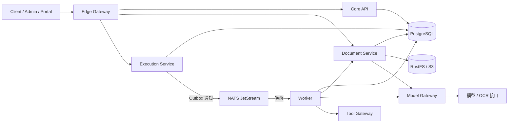

# 合同智能审计工作台

基于 Go 和 React 的合同审计工作台，用于组织合同材料、执行规则核对、查看带引用的模型建议，并记录人工复核、整改和复审。

业务工作台展示“第一届黄桷树AI智能体开发大赛”标题及赛事 Logo，产品名称为合同智能审计工作台。

审查结果引用材料时，系统会保留跨行的否定词和限制条件，并记录引用在本次审查原文中的位置。制度按租户、制度标识和版本号区分；不同租户可以各自保存同名制度，已有版本不会被改写。知识库可以选择和读取指定版本，也支持版本链接；旧的单 ID 接口仍读取最新记录。

制度、操作指引、例外和经审阅的经验都有版本记录；提交、校验、审批和发布也会留下历史。发起审查时，系统根据业务时间、租户、案件权限和规则包版本选择可用知识，并保存本次执行使用的版本和内容摘要。之后更新或撤回知识，不会改变之前的审查记录。系统支持的制度数值要求必须能从原文提取并与规则包一致；无法核实时会保留待补充事项。

审查人员可以针对发现的问题提交反馈，并引用本次审查使用的原文，作为整理经验的依据。这些经验需要审阅、授权和发布，之后符合适用范围的案件才能选择使用。模型和智能体给出的内容只是建议；找到原文引用与按规则比较是两个不同步骤。无法核实的结果会保持待核实或信息不足，不会自动成为已确认结论。

发现材料不足时，可以根据已保存的规则检查或审查待补充事项发起补充材料请求，并关联案件任务、材料和回执。收到材料后，需要重新发起审查，核对新的检查结果和原文引用，才能完成核验。之前的执行记录、人工判断和请求历史都会保留。

## 项目架构

前端使用 React、TypeScript、Ant Design 和 TanStack Query，分为业务工作台 Client、规则管理 Admin 和接口文档 Portal。后端使用 Go 和 Eino，提供案件、文档、审查执行、模型调用和工具服务。PostgreSQL 保存业务状态与执行记录，RustFS/S3 保存原件，NATS JetStream 用于独立服务模式下的事件通知。

三站共用 Ant Design 主题：导航使用黑色并按功能分组，保留标准图标，不显示菜单编号；内容使用白色和浅蓝灰，主要操作与选中项使用蓝色。蓝、橙、红、绿分别表示信息与进度、警告、错误和成功状态。颜色由 `web/src/styles.css` 的语义 Token 定义，经 `web/src/bootstrap.tsx` 配置到组件；普通链接样式置于组件样式之前，保留主按钮和状态标签的对比度。

主页的审查链路和业务模块标题使用 17px，统计卡片标题使用 15px，窄屏沿用相同层级。宽屏时任务窗格与右侧统计窗格上下对齐，窄屏按可用宽度重排。

系统健康页按分组展示服务状态、连接目标和观测说明，支持筛选、搜索和查看详情。版本对照页在宽屏并排显示各次审查使用的原文，窄屏纵向排列；选择审查发现后，可以找到对应的原文。

审查工作区顶部可以打开执行检查器，按时间线或事件树查看本次执行保存的事件。选择事件后，可以查看阶段、状态、用量和关联编号，也可以切换到之前的执行记录。没有记录的数据会显示为未知。

独立服务按下图组织：



本地开发默认使用 `cmd/server` 的单进程模式，将 API 和审查执行放在同一进程中；独立服务模式使用各自的启动入口和数据库角色。

```text
cmd/                 服务、迁移和命令行入口
internal/            业务逻辑、规则、解析、权限、存储和服务客户端
web/                 Client、Admin、Portal 源码与前端配置
deploy/               Docker 镜像、Nginx 配置和基础设施脚本
deployments/          Compose 启动工具与 Kubernetes 配置
scripts/             开发、测试和验证脚本
testdata/            小型回归测试输入
compose.yaml         PostgreSQL、RustFS 等本地基础设施
compose.app.yaml     独立服务部署配置
```

仓库保留源码、配置、依赖锁文件和必要的小型测试资源。合同样本、演示预置材料、设计文档、截图、课件、模型权重和运行产物不随源码提供。

## 本地启动

需要 Go 1.26.7+、Bun 1.4.3、Node.js 22.12+、Python 3.10+，以及可用的 Docker Engine/Desktop 和 Compose v2。解析 PDF 还需要 Poppler 的 `pdfinfo`、`pdftotext`、`pdfimages`、`pdftoppm` 及 CJK mappings。

在仓库根目录安装依赖、生成本机配置并启动基础设施：

```bash
make setup
make infra-bootstrap
make infra-config
make infra-up
make infra-smoke
```

`infra-bootstrap` 生成私有的 `.env` 和 `.env.distributed`，已有文件不会被覆盖。配置项见 [.env.example](.env.example)。数据库和对象存储凭据保存在本机，不提交到 Git。

Go 不会自动加载 `.env`。在第一个终端启动 API：

```bash
set -a
source .env
set +a
make dev
```

在另一个终端启动前端：

```bash
make web
```

默认 API 地址为 `http://127.0.0.1:8080`，前端为 `http://127.0.0.1:5173`。Vite 将 `/api` 和 `/openapi.json` 代理到 API，可通过 `VITE_DEV_API_PROXY` 修改目标地址。

开发和测试模式提供以下固定演示账号；生产环境禁止使用这些账号，配置企业身份目录时本地密码登录也会停用。账号默认仅能访问自己创建或明确加入的案件，租户和组织由服务端绑定。

| 账号 | 密码 | 角色 | 租户 | 组织 |
|---|---|---|---|---|
| `demo-admin` | `admin-demo` | 管理员 | `local-demo` | `demo-org` |
| `demo-clerk` | `clerk-demo` | 经办 | `local-demo` | `demo-org` |
| `demo-reviewer` | `reviewer-demo` | 审查员 | `local-demo` | `demo-org` |
| `demo-viewer` | `viewer-demo` | 只读 | `local-demo` | `demo-org` |
| `demo-otherorg-clerk` | `otherorg-clerk-demo` | 经办 | `local-demo` | `demo-other-org` |
| `demo-tenant2-admin` | `tenant2-admin-demo` | 管理员 | `local-demo-2` | `demo-org-2` |
| `demo-tenant2-clerk` | `tenant2-clerk-demo` | 经办 | `local-demo-2` | `demo-org-2` |
| `demo-tenant2-reviewer` | `tenant2-reviewer-demo` | 审查员 | `local-demo-2` | `demo-org-2` |
| `demo-tenant2-viewer` | `tenant2-viewer-demo` | 只读 | `local-demo-2` | `demo-org-2` |

模型与 OCR 服务需自行提供，在 `.env` 中设置 `LLM_BASE_URL`、`LLM_MODEL`、`OCR_MODEL` 和 `LLM_API_KEY`。模型不可用时，相关审查会按执行结果记录失败或部分完成，不会自动产生模型结论。

模型名称必须与该端点的 `/v1/models` 目录一致。代理目录可能包含提供方前缀；不要把请求能够接受的别名当作目录中的正式模型 ID。

### 真实合同联调

原件和运行记录放在源码仓外。在仓库外准备版本 1 的 JSON 清单，包含 `version`、`dataset_id` 和 `cases`；每个案例包含 `id`、`title`、`contract_type` 和 `materials`。每项材料需要 `role`、相对清单的 `path`、`sha256`、`source` 和 `data_class: "original"`；角色可以是 `draft_contract`、`procurement`、`award` 或 `attachment`。材料之间的关系和审查结论需要人工核验。

```bash
python3 scripts/record_model_proxy.py --upstream http://127.0.0.1:3425/v1 \
  --listen 127.0.0.1:3426 --out ../contract-audit-delivery/model-records/real-run
```

第二个命令保持运行，并在独立服务的模型配置中将 `LLM_BASE_URL` 指向该记录器，`LLM_MODEL` 与 `OCR_MODEL` 均设为真实模型目录中的名称。记录器只监听宿主机回环地址；容器服务需要受限的宿主网络转发才能访问。计算冻结模型身份的各服务必须使用相同的地址和模型名称。记录器只转发真实上游响应，不保存请求头，但请求和响应正文可能包含合同、图片及其他敏感数据，必须保存在私有目录。上游是否转发到外部取决于实际模型服务。

扫描页逐页转写。单文件上限为 32 MiB，模型网关仍按请求体字节作保守预算预留；需要根据页面大小和频率调整 `MODEL_MAX_INPUT_TOKEN_RESERVATION`、`MODEL_TENANT_TOKENS_PER_MINUTE`、`MODEL_GLOBAL_TOKENS_PER_MINUTE`。要覆盖最大 33 MiB 模型请求，单次预留至少为 34603008，全局与租户每分钟预算均须大于单次预留和输出额度之和。长文档还需按实际耗时配置 `DOCUMENT_PARSE_TIMEOUT`、`GATEWAY_REQUEST_TIMEOUT` 和 `GATEWAY_UPLOAD_TIMEOUT`；文档解析超时上限为 30 分钟。

模型网关对已声明超过 33 MiB 的请求在读取正文前拒绝；未声明长度的流仍在读取时按相同字节上限限制。

材料上传、重新解析和草稿生成在进入解析队列前检查角色与案件权限，提交时再次检查；队列满时仅对已授权请求返回容量不足。

DOCX 正文中的 Adobe Symbol 字体字符按 Unicode 映射保留；不支持的符号字体、无可靠文本映射的字形或无效编码会使解析失败，不会被静默丢弃。

服务就绪后执行：

```bash
python3 scripts/run_real_corpus.py \
  --manifest ../contract-audit-delivery/real-corpus/manifest.json \
  --base http://127.0.0.1:8080 \
  --request-timeout 1800 --review-timeout 900 \
  --model-record-dir ../contract-audit-delivery/model-records/real-run
```

使用 `--case-id` 指定清单中的单个案例；省略时顺序运行全部案例。每次创建新的案件，在 `contract-audit-delivery/test-runs/` 保存输入哈希、解析状态、案件及审查标识、冻结快照、执行事件和发现；失败时保留已完成的记录。必须指定已存在的记录器目录，运行期间的模型调用会复制到本次结果的 `model-calls/`。请为每次运行使用独立记录器或顺序执行，避免按时间归档时混入并发调用。模型正文可能包含敏感材料，记录器不保存凭据头。报告和人工决定不会自动创建。

验证演示账号的案件授权和租户隔离，可对真实运行的 API 执行：

```bash
python3 scripts/check_real_access.py --base http://127.0.0.1:8080 \
  --manifest ../contract-audit-delivery/real-corpus/manifest.json
```

命令创建独立验证案件，记录不同账号对案件列表、原件、成员和写操作的实际状态码；结果保存在仓库外的 `test-runs/`。

本地停止基础设施可执行 `make infra-stop`，该命令保留数据卷。

业务数据库使用 PostgreSQL 18，数据卷为 `pgdata18`，挂载到 `/var/lib/postgresql`。旧 PostgreSQL 17 数据卷不能直接交给 18 使用：先备份、创建新卷，再用 `pg_dump` / `pg_restore` 迁移并验证。旧卷应保留到回退窗口结束；新库有业务写入后，回退还需要处理新增数据。Keycloak 的身份库独立保留 PostgreSQL 17，不随业务库升级。

## 本地 MinerU

[MinerU 4.x](https://github.com/opendatalab/MinerU) 可以作为本地 OCR 服务。NVIDIA 环境使用隔离的 Python 3.12 安装推理依赖和模型；权重放在仓库外：

```bash
uv tool install --python 3.12 'mineru[full]==4.0.12'
mineru-kit models download --tier standard --small-backend torch --vlm-engine vllm --source modelscope
mineru-kit models verify --tier standard --small-backend torch --vlm-engine vllm
mineru-openai-server --engine vllm --host 127.0.0.1 --port 30000 --gpu-memory-utilization 0.45 --max-model-len 8192 --max-num-seqs 1 --limit-mm-per-prompt '{"image":1}' --enforce-eager
```

在另一个终端启动解析 API：

```bash
MINERU_MODEL_SMALL_BACKEND=torch MINERU_MODEL_VLM_ENGINE=vllm mineru-kit api-server --host 127.0.0.1 --port 18000 --tier standard --concurrency 1 --vlm-server-url http://127.0.0.1:30000 --vlm-max-concurrency 1
```

RTX 4070 SUPER 12GB 已用上述配置完成扫描 PDF 和图片的标准解析。实际占用取决于页面、上下文和并发，不应直接增加并发。WSL 的基础版 llama.cpp 可能只检测到 CPU；GPU 是否生效应以 CUDA 推理日志为准。

工作台现有 OCR 边界为 `store.Models.Transcribe(context.Context, media, body)`。本地集成验证通过此回调调用 MinerU 的 `/v1/file_parse`，保留原件、不可变解析产物、`FromOCR` 和可定位引用；当前服务入口仍使用原有 OpenAI 模型配置，没有把 MinerU V1 解析 API 当作 `/chat/completions`。部署接入需保留 Model Gateway 的授权和预算边界。原生 DOCX 继续使用现有解析器：MinerU Flash 在复杂 DOCX 样本中会输出隐藏文字，不能直接替换合同可见正文提取。

## 独立服务启动

完成上述配置，并确认模型接口可以从容器访问后，构建并启动独立服务：

```bash
make apps-up
```

此入口通过 `compose.app.yaml` 启动 Gateway、Core、Document、Execution、Worker、Model/Tool Gateway 和三个前端站点。模型接口必须在容器网络中可达；容器内的 `127.0.0.1` 指向容器自身。主机端口由 `.env` 中的 `EDGE_PORT`、`CLIENT_PORT`、`ADMIN_PORT` 和 `PORTAL_PORT` 控制。

在私有配置中设置 `OBSERVE=1` 和 `GRAFANA_ADMIN_PASSWORD` 后，`apps-up` / `apps-up-fixture` 同时启动 Collector、Tempo、Prometheus 和 Grafana，`apps-down` 同时停止这些服务。应用的 `OTEL_EXPORTER_OTLP_ENDPOINT` 应设置为 `http://otel-collector:4318`。Grafana、Tempo、Prometheus 默认仅绑定主机回环端口 13000、13200、19090。导出只包含执行元数据；事件指标使用累计计数，最多保留 256 个标签组合，溢出组合汇总到 `__overflow__`。`MetricsExported` / `MetricsFailed` 分别统计被接收和被拒绝或未确认的数据点。

分站部署时，通过 `VITE_ADMIN_URL` 指定 Admin 地址；留空时使用同源 `/admin/rulepacks`。三个站点也可以分别构建：

```bash
make web-client
make web-admin
make web-portal
```

## 本地 Kubernetes 仿真（k3d）

`deployments/k3d.py` 在一台主机上用 k3d 启动 1 个控制节点和 2 个工作节点的隔离集群，用于验证 Kubernetes 部署行为。集群使用独立的 kubeconfig，不切换当前默认上下文；私有凭据写在仓库外的交付目录。

```bash
python3 deployments/k3d.py up       # 创建或复用 caw-local 集群并导出独立 kubeconfig
python3 deployments/k3d.py deploy   # 导入本地镜像，创建命名空间与私密 Secret，执行迁移和应用部署
python3 deployments/k3d.py status   # 查看节点、工作负载和端口转发命令
python3 deployments/k3d.py smoke    # Service DNS/HTTP、数据库 DNS、Pod 重建、Worker 1→2→1 与滚动重启
```

三个前端站点通过端口转发访问 18080（client）、18081（admin）、18082（portal）。集群内使用 fixture 模型配置，不调用外部付费模型。

三个节点的容器仍共享同一台物理主机，因此该结果只能证明部署、调度、副本伸缩、滚动更新和 Pod 故障恢复行为，不能当作物理机高可用或跨故障域容灾的验收证据。需要独立存储故障域、异地备份或真实性能结论时，应在多台主机组成的集群上另行测量。

Admin 的「基础设施与中间件」页面（`/admin/infrastructure`）列出生产目标架构的组件、依赖边界、当前观测接入情况和生产验收状态。没有集群观测来源的组件显示为未接入，单实例容器健康不会被写成生产高可用；生产验收未执行时保持 `NOT_RUN`。

## 开发检查

运行本地 Go 测试或 `make verify` 前，先从固定公开测试资产发布准备仓库外的法律来源快照；脚本会校验归档及文件 SHA256，重复运行可复用相同内容：

```bash
python3 scripts/fetch_legal_test_assets.py --destination ../contract-audit-delivery/legal-test-assets-20261031-v1
export CAW_LEGAL_TEST_ROOT="$(realpath ../contract-audit-delivery/legal-test-assets-20261031-v1)"
export LEGALNORM_ASSET_DIR="$CAW_LEGAL_TEST_ROOT/legal-sources"
export LEGALNORM_CANONICAL_MANIFEST="$CAW_LEGAL_TEST_ROOT/p4-canonical-articles-v2.json"
```

这些固定原始快照的采集时间和 SHA256 仅用于可重复回归，不证明法律当前持续有效。CI 会自动准备测试资产；它们不是应用发布内容。

```bash
make test-unit                  # 不依赖数据库或模型的 Go 测试，包含 race
cd web
bun run typecheck
bun run test
bun run build
```

需要数据库的集成测试使用隔离的 `TEST_DATABASE_URL`，`MIGRATOR_DATABASE_URL` 指向同一测试库的迁移角色；`MODEL_DATABASE_URL` 指向同库的独立非特权登录角色。专用角色不能是超级用户、表所有者或具有 `BYPASSRLS`，配置示例见 CI 的数据库角色准备步骤。`make verify` 执行确定性检查，`make acceptance` 进一步执行浏览器旅程；真实模型/OCR 联调由 `make test-live` 单独启用。

## 开发状态与验收记录

当前原功能开发已暂停，剩余范围跟踪于 [Issue #7](https://github.com/Rupert-WLLP-Bai/contract-audit-workbench/issues/7)。以下历史记录仅对应当时的源码候选与验收，不表示全部交付；其中 `f427153` 是 Jev 建议层接入前的候选。

1. **PASS：修复前端类型检查。** `web/src/app.integration.test.tsx` 的 breadcrumb 查询已收窄为 `HTMLElement`。最终 `make acceptance` 中 `web-typecheck` 通过，`web-tests` 371/371 通过，`web-build` 通过。
2. **PASS（本地）：完成全量发布验收。** 在隔离 PostgreSQL 18（一次性容器 `caw-accept-pg`）上执行 `make acceptance`；`artifacts/verification.json` 为 `passed:true`，21 项检查全部返回 0，源码身份摘要 `0285f4b2cb0d7d90ef4d6edf3f93fb2082dea969a42155d55a31e75697ff7f82` 与最终可执行工作树一致；`browser-system` 耗时 90.1s，`TestBrowserWarrantyConflictAndConfirm` 与 `TestBrowserTelecomC1BFullJourney` 均 PASS。远端 CI 在推送后另行记录，不能把本地结果当作远端通过。
3. **PASS：M1/M2 业务闭环实机验收。** `web/e2e/functional/workflows.spec.ts` 在 5 节点集群上 4/4 PASS：经验反馈→异步蒸馏→候选（11.8s）、知识版本审批/发布（2.7s）、补件请求→回执→后续审查核验（11.4s）、报告业务视图隐藏原始标识（5.7s）。普通用户/管理员权限、撤权与浏览器缓存旅程 `identity-sse.ts`、`sessions.spec.ts` 本轮未运行（`NOT_RUN`）；报告字节不变、冻结快照和权限边界已由浏览器/API 断言覆盖。
4. **PASS（受控小样本）：性能复测。** 隔离 Compose、fixture 模型、18 个案件、并发 1/2、3 次重复；18/18 到达机器终态（18 partial，0 failed，0 关系错误，0 refused，0 transport error），端到端 p50 1.781s / p95 2.941s，队列等待 p50 0.279s / p95 1.620s，吞吐 21.5 req/s；audit-execution RSS 22.5–31.7 MB，Worker RSS 12.4–16.4 MB，模型预算无残留。小样本不等于生产 SLA；PostgreSQL/RustFS 容器未纳入资源采样。详见仓库外交付目录的 `docs/distributed-verification-2026-10-28.md`。
5. **BLOCKED：完成反馈收益对照。** 八组来源 A 均为 `PARTIAL`，未发现可核实的来源误报；已运行 G0/G1 各 32 个目标样本，其中 G0 完成 17 个、G1 完成 0 个。G2 的 32 个样本为 `NOT_RUN`，没有人工裁决，不能计算误报下降或宣称零漏报。只有取得可核实的来源纠正、经授权审阅并发布经验后，才能继续 G2；失败、弃权和未完成样本保留在分母中。
6. **NOT_APPLICABLE：本地 Jeva/Laya。** 适配器与 provider 已删除，仓库不再包含本地 System One 调用路径；仅保留 `internal/jev` 的 TypeSafe 托管调用。
7. **PASS（代码与测试）：TypeSafe Jev 建议层。** Jev 默认以 `advisory` 配置进入受治理知识 rerank，只重排 optional 候选；结论、引用、算术、证据、状态和人工决定仍由确定性代码负责。全量 `make verify` 在本工作树 20/20 检查 PASS，`artifacts/verification.json` 为 `passed:true`，源码身份摘要 `4c675b22cc5178866d00874f36aa200940f5f8815d329107e81469c54a22fff9`，数据库集成测试 0 跳过、0 失败。浏览器验收和真实托管评测为 `NOT_RUN`。托管端点只接收 `minimized` 元数据，不得发送冻结合同原文。

### TypeSafe Jev：默认开启的建议层，规则拥有结论

Jev 有两条路径，二者不共用结论权：

1. **审查路径（默认开启的建议层）**：`TYPESAFE_JEV_MODE=advisory` 时，worker 从审查接受时冻结的 `PlannerConfiguration.Advisory` 读取配置，通过 model-gateway 的 `/v1/systemone` 对受治理知识的 optional 候选做相关性 rerank。它只影响 optional 候选的先后；required 候选、确定性分数、候选全集、预算、`AcceptedRules`、引用定位、关系、缺口状态、严重度和人工决定都不变。0.70/0.30 三档，中间值进入 `uncertain`；失败、超时、预算不足、模型版本不一致或非法响应一律回退到确定性顺序，并记录 `unavailable` 等状态。判断先写入不可变 `advisory_judgments`，再用于排序；同一 run 的同一冻结输入复用已有判断。
2. **影子评测（默认关闭）**：`cmd/ruleshadow -backend jev` 继续只用于 D0 合成 `review_focus` 对照，不进入审查路径。2026-10-28 的单次运行结果仍是 40/40 强制规则输出不变、39/40 标签一致、p50 300ms / p95 427ms；该结果只证明建议层可用，不是生产准确率。

```text
TYPESAFE_JEV_MODE=off|fixture|advisory   # 未设置时按 off；部署清单显式写 advisory
TYPESAFE_JEV_EGRESS=minimized            # Phase 1 只实现 minimized
TYPESAFE_JEV_FEATURES=knowledge_rerank
TYPESAFE_JEV_MODEL=jev-1.14.0            # advisory 必须固定版本，拒绝 jev-latest 等 alias
TYPESAFE_JEV_PROVIDER=model-gateway      # 分布式默认；单进程本地开发可用 direct
TYPESAFE_JEV_TIMEOUT=3s
TYPESAFE_JEV_MAX_CANDIDATES=16
TYPESAFE_API_KEY=                        # 只放 model-gateway 的 secret
```

- **默认开启的含义是部署默认，不是每次审查必调**：没有 optional 候选、字段无法安全最小化、预算耗尽、feature 未启用或数据审批未完成时都不调用；这些情况在冻结记录和健康页显示为 `not_applicable`/`unavailable`，不能静默当成“不相关”。
- **数据边界**：`minimized` 只发送业务线/场景/合同类型、gap 的 domain/capability/reason 标签、治理知识的 kind/summary/check_action/minimum_evidence 等治理元数据；不发送合同原文、文件名、案件/当事方标识或引用。发送前对 URL、邮箱、电话、日期、金额和长标识做确定性脱敏；治理知识本身也不得写入当事方名称等案件信息。`approved_text` 尚未实现，客户端和网关都会拒绝。冻结合同原文在数据出境/第三方处理审批完成前不得发送。
- **失败回退**：Jev 关闭、缺 key、超时、429/5xx、非法 JSON、越界概率或观测模型与冻结版本不一致时，审查继续使用确定性结果；Jev 故障不影响 chat/OCR readiness。
- **密钥位置**：分布式部署只有 `model-gateway` 持有 `TYPESAFE_API_KEY`；worker 只拿 `WORKER_MODEL_TOKEN`，health-monitor 通过网关的 `/health/jev` 读取非秘密状态。单进程本地开发和 `cmd/ruleshadow` 合成评测可直接从环境读取 key。
- **生产门槛**：仓库清单默认写 `advisory`，但数据出境审批未完成时必须覆盖为 `off`，并在健康页明确显示关闭。健康页只报告 mode/model/egress/feature 和 key 是否存在，不返回 key、state 或答案。

`make verify` 和单元测试显式设置 `TYPESAFE_JEV_MODE=off` 并移除继承的 `TYPESAFE_API_KEY`；CI 不访问 `api.typesafe.ai`。k3d/Compose fixture profile 用 `TYPESAFE_JEV_MODE=fixture` 的网关返回确定性答案，worker 仍走 advisory→gateway 路径，用于验证预算、审计和回退，不能当作模型质量证据。

### 分布式与 Eino 证据

- **PASS**：5 逻辑节点（1 server + 4 agents）、Core 2/Worker 3/Model 2/Tool 2 实际分布到不同 agent、健康页服务组/期望副本/实例/节点、分布式 Chromium C1-B 完整旅程、Worker 接管（generation 1→2）、Core 切换（12/12 HTTP 200）、NATS 中断恢复、NATS 3 节点 Stream R=3、OTel→Tempo/Prometheus/Grafana、结构化分布式日志、RustFS 单节点对象读写、PostgreSQL 单节点权威队列与 Outbox。
- **BLOCKED**：PostgreSQL 3 实例（缺少 CNPG operator/CRD 与镜像）、RustFS 4 节点/16 PVC（缺少 Helm chart/安装前提）、集中式日志后端（缺少 Loki/Promtail 镜像）。单节点 PostgreSQL/RustFS 已真实接入并验证，复制形态未冒充通过。
- **Eino**：经验反馈、异步蒸馏、候选审阅在真实浏览器 PASS；候选发布为受治理经验、快照选择、撤权重验由 store 集成测试 PASS；候选的浏览器端发布/后续复用为 `NOT_RUN`（fixture 候选没有 policy_refs，未伪造）。同一 attempt 的接管恢复和失败工具观察恢复有代码与测试；成功工具输出的精确恢复受当前持久化模型限制，标 `NOT_RUN`。
- 详细记录：`../contract-audit-delivery/implementation/2026-10-27/docs/distributed-verification-2026-10-28.md`、`.../docs/eino-memory-distillation-learning-2026-10-28.md`、`.../docs/terminology-glossary-2026-10-28.md`。

此前一个合成图片样本完成真实 OCR 和冻结审查；一次独立的补件接口冒烟完成 `open → received → verified` 并确认旧快照未变。这些只是单次路径证据，不代表整体准确率。较大的图片样本转写失败，仍需调查请求大小与模型预算限制。

按仓库边界，试点脚本、合成语料、逐项报告、模型调用记录和验收产物位于本机仓库外的 `../contract-audit-delivery/implementation/2026-10-27/`，没有推送到源码仓。换机器如需复用历史证据或继续试点，须单独迁移该交付目录中的必要文件；不要复制私有凭据。独立服务的 Core/Worker 结果回传需要配置不同于其他服务凭据的 `WORKER_CORE_TOKEN` 和 `CORE_SERVICE_URL`；旧本地配置缺项时须补齐后再启动。

### 跨系统核验与保守增量复审（默认关闭）

新增的 `internal/auditext`、`capability-packs`、`internal/capabilitypack`、`internal/externalread`、`internal/fulfillment`、`internal/reviewimpact` 以及 Core 侧持久化/API，用于验证“合同约定 ↔ 授权业务记录”的差异：

- 能力包只声明场景、材料角色、RulePack 精确版本、只读能力和比较器；不加载脚本、SQL 或可执行插件。
- 对象映射必须由人工确认；采集与核验受理分开，失败读只形成 `unavailable`/`rejected` 观测。
- 核验使用精确十进制和单位归一；配置带宽不等于实际吞吐，不自动确认风险、不计算赔偿。
- 影响计划只提供 explain/shadow；依赖不完整、集合成员变化、旧证据不可重绑定或候选/全量结果不一致时强制 full，业务结果始终来自完整执行，reuse 保持关闭。

默认 `OPERATOR_AUDIT_ENABLED=false`，路由返回 503，前端入口不显示。开发/测试可显式启用合成连接器：

```text
OPERATOR_AUDIT_ENABLED=true
EXTERNAL_EVIDENCE_MODE=fixture
EXTERNAL_EVIDENCE_CONNECTOR_ID=fixture.oss
EXTERNAL_EVIDENCE_SOURCE_SYSTEM=fixture-oss-east
```

`fixture` 模式只允许在 development/test 使用，读取仓库内合成的 OSS 记录；`live` 模式需要另行完成数据出境/处理审批和真实来源接入，本版本不启用。启用后审查页会出现「进入跨系统核验」入口，页面遵循现有案件权限；未授权请求不返回快照内容。相关黑盒测试：`make test-unit`（含 `^TestOperator`）和 `make verify`；浏览器 R1 旅程仍需在具备数据库/浏览器环境中单独执行。

## 分支工作方式

`main` 保存通过验收的交付版本，`feat/<主题>` 汇集正在开发的变更。功能通过审查与验收后，通过 PR squash 合并到 `main`；交付后将功能分支同步到 `main`。需要单人作者时，提交前检查 `git var GIT_AUTHOR_IDENT` 和 `git var GIT_COMMITTER_IDENT`，使用本人身份，不添加代理作者或 `Co-authored-by`。既有已发布提交不重写。

```bash
git switch main
git switch -c feat/mineru-integration
```
