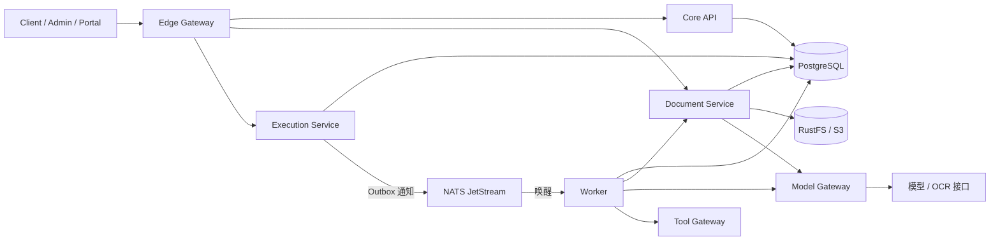

# 架构概览

系统由 Client、Admin 和 Portal 三个前端入口与 Go 服务组成。单进程开发入口是 `cmd/server`；独立部署由 Gateway、Core、Document、Execution、Worker、Model Gateway 和 Tool Gateway 组成。服务间职责和运行方式见[部署模式](../operations/deployment.md)。

PostgreSQL 是业务和任务状态的权威存储；NATS 用于短通知。对象原件保存在 S3 兼容对象存储。服务使用独立数据库角色，租户 RLS 和对象级授权均须保留。工具网关提供只读证据接口。

## 前端与视觉约定

Client、Admin 和 Portal 使用 React、TypeScript、Ant Design 与 TanStack Query。三站共用语义主题：导航按功能分组，页面使用白色和浅蓝灰底，主要操作与选中项使用蓝色；蓝、橙、红、绿分别表示信息/进度、警告、错误和成功。颜色沿用 `web/src/styles.css` 的语义 Token，由 `web/src/bootstrap.tsx` 配置到组件。列表保持白底，汇总区域透明；数字本身保持中性。

主页业务模块标题使用 17px，统计卡片标题使用 15px，窄屏保持同一层级。宽屏任务窗格与统计窗格上下对齐；窄屏按可用宽度重排。菜单与页面路由分别在 `web/src/app.tsx`、`web/src/admin-app.tsx` 等前端入口维护。

## 主要源码位置

| 路径 | 职责 |
| --- | --- |
| `cmd/server/`、`internal/bootstrap/` | 单进程入口及服务装配 |
| `cmd/gateway/`、`internal/gateway/` | 外部路由与独立服务凭据转发 |
| `cmd/worker/`、`cmd/auditexecution/` | PostgreSQL 任务领取、租约与审查执行 |
| `cmd/documentservice/`、`internal/documentparse/` | 材料授权、解析和原文定位 |
| `cmd/modelgateway/`、`cmd/toolgateway/` | 模型调用预算与只读证据工具 |
| `internal/store/`、`internal/httpapi/` | 持久化、冻结记录、授权查询与 HTTP 契约 |
| `internal/engine/`、`internal/agentflow/` | 确定性规则、智能体编排与引用核验 |
| `internal/rulepack/`、`capability-packs/` | 版本化规则与业务能力包 |
| `internal/evidencebundle/`、`cmd/verify-evidence/` | 签名证据包和独立验证 |
| `internal/apidocs/openapi.json` | HTTP wire 契约；前端类型由 `scripts/generate_openapi_types.py` 生成 |

目录结构与日常入口见[本地开发](../engineering/local-development.md)。
